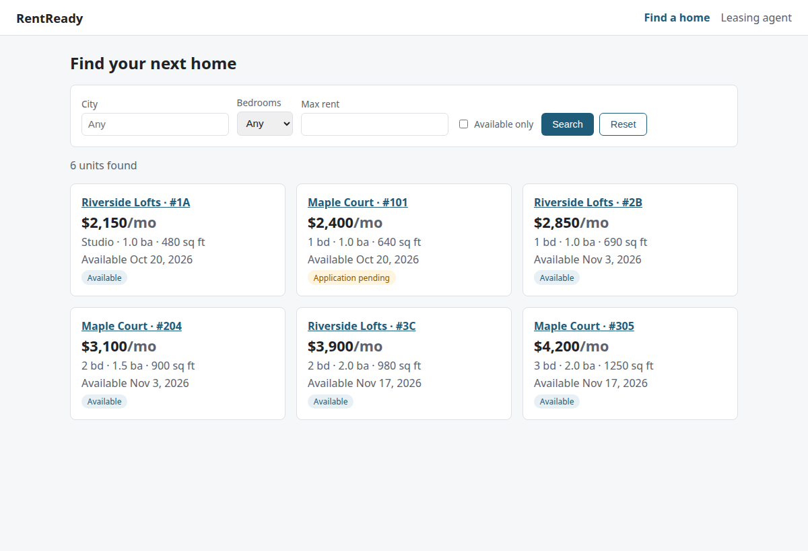
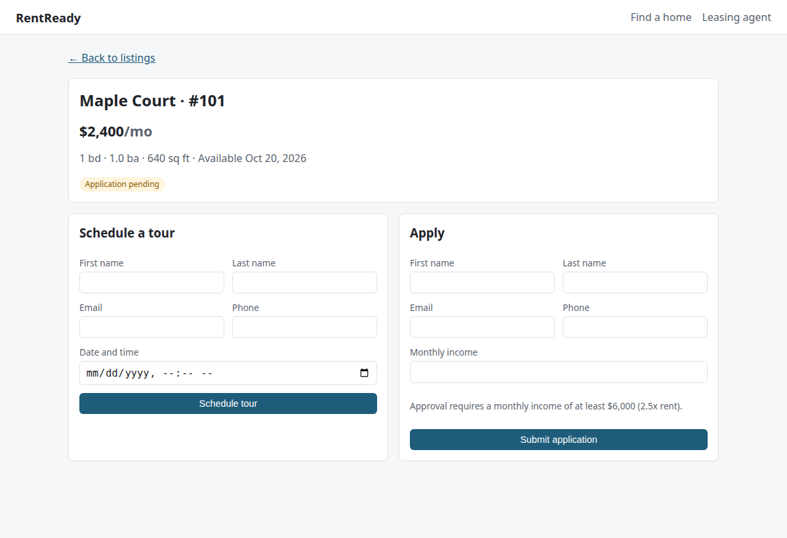
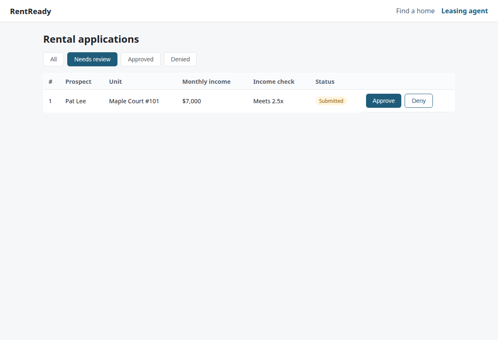

# RentReady Web

A React frontend for the [RentReady Django API](https://github.com/realarnesh/rentready). Renters can browse and filter apartments, schedule tours, and apply. Leasing agents can review applications and approve or deny them.


| Listings | Unit detail | Leasing agent dashboard |
|---|---|---|
|  |  |  |

## Features

- **Listings** with filters for city, bedrooms, max rent, and availability. Filters are stored in the URL, so searches survive a refresh and can be shared.
- **Unit detail page** with a tour form and an application form
  - Reuses an existing prospect by email instead of creating duplicates
  - Shows the 2.5x income-to-rent requirement and warns before submitting if income falls short
  - Hides the forms when a unit is already leased
- **Leasing agent dashboard** with status tabs, an income check column, and approve/deny actions. The list refreshes after each decision, because approving one application automatically denies competing ones on the server.
- **Error handling**: Django REST Framework validation errors (for example, a double-booked tour) are turned into readable messages in the UI
- **17 tests** (Vitest + React Testing Library) with a mocked API, plus ESLint, all run in GitHub Actions

## Tech stack

JavaScript, React 18, React Router, Vite, Vitest, React Testing Library, ESLint, GitHub Actions

## Run it locally

Start the API first (see [realarnesh/rentready](https://github.com/realarnesh/rentready)):

```bash
python manage.py migrate && python manage.py seed_demo && python manage.py runserver
```

Then start the frontend:

```bash
npm install
npm run dev        # http://localhost:5173
```

The Vite dev server proxies `/api` to `http://127.0.0.1:8000`. Set `VITE_API_TARGET` to point it elsewhere.

```bash
npm test           # run tests
npm run lint       # lint
npm run build      # production build
```

## Project structure

```
src/
  api.js                  API client, error formatting, getOrCreateProspect
  useApi.js               Data-loading hook with request cancellation
  format.js               Currency, date, and label helpers
  App.jsx                 Routes and navigation
  pages/
    ListingsPage.jsx      Search and results
    UnitDetailPage.jsx    Unit info, tour and application forms
    AgentDashboard.jsx    Application review
  components/             Filters, UnitCard, TourForm, ApplicationForm, StatusBadge
  test/                   Test setup and fetch mocking helpers
```

## Notes

This is a portfolio project. Authentication is intentionally left out, so the leasing agent dashboard is open to anyone running the app locally. A production version would add login and role-based access for renters and agents.
